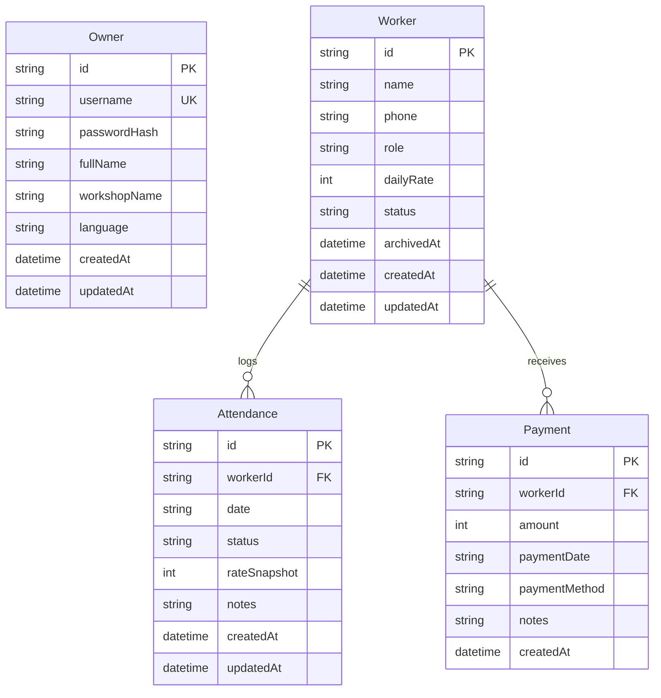

# AKFA Workshop Management System — Database Schema (PostgreSQL / Neon)

## 1. Entity-Relationship Diagram

---

## 2. Model Specifications

### 2.1. `Owner`
Stores workshop owner credentials and profile configurations.
- `id`: UUID Primary Key.
- `username`: Unique username (default `admin`).
- `passwordHash`: Bcrypt hash of owner password.
- `fullName`: Full name of owner (e.g., "Alisher Qodirov").
- `workshopName`: Name of workshop (e.g., "AKFA Rom va Eshiklar Tsexi").
- `language`: Preferred UI language (`uz` or `ru`).

### 2.2. `Worker`
Records aluminum and PVC workshop craftsmen.
- `id`: UUID Primary Key.
- `name`: Full name.
- `phone`: Contact phone number (formatted e.g. `+998 90 123 45 67`).
- `role`: Craftsman role (`usta`, `shogird`, `yordamchi`, `ornatuvchi`, `boshqa`).
- `dailyRate`: Agreed wage rate per day in UZS (Integer to avoid precision loss).
- `status`: Lifecycle status (`ACTIVE` or `ARCHIVED`).
- `archivedAt`: Timestamp when archived (NULL when active).

### 2.3. `Attendance`
Daily workshop attendance journal.
- `id`: UUID Primary Key.
- `workerId`: Foreign key to `Worker`.
- `date`: ISO Date string (`YYYY-MM-DD`).
- `status`: Binary attendance (`PRESENT` or `ABSENT`).
- `rateSnapshot`: Historical snapshot of worker's daily rate on this specific date. Guarantees that rate changes do not alter historical calculations.
- `notes`: Optional note (e.g. "Kechikdi", "Yarim kun").
- **Constraints**: `UNIQUE(workerId, date)`.

### 2.4. `Payment`
Wage and advance distribution records.
- `id`: UUID Primary Key.
- `workerId`: Foreign key to `Worker`.
- `amount`: Amount paid in UZS. Supports partial payments.
- `paymentDate`: ISO Date string (`YYYY-MM-DD`).
- `paymentMethod`: `CASH`, `CARD`, or `BANK_TRANSFER`.
- `notes`: Optional transaction note.

---

## 3. Database Indexes

- `Worker(status)`: Fast filtering of active vs archived workers.
- `Attendance(date)`: Rapid lookup of daily attendance roster.
- `Attendance(workerId)`: Fast aggregation of worker attendances.
- `Payment(workerId)`: Fast calculation of total payments per worker.
- `Payment(paymentDate)`: Fast generation of payment ledger history.
