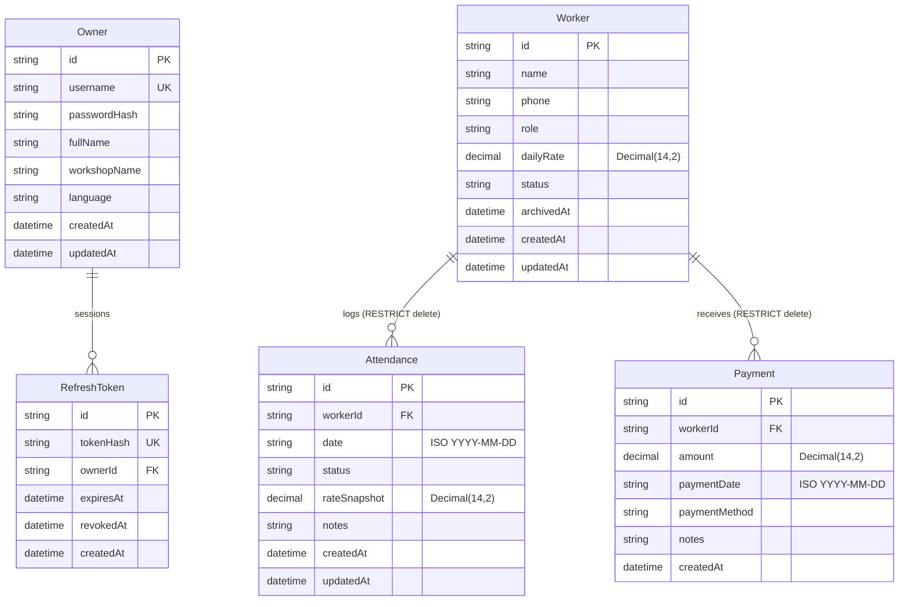

# AKFA Workshop Management System — Database Schema (PostgreSQL / Neon)

## 1. Entity-Relationship Diagram

---

## 2. Model Specifications

### 2.1. `Owner` (`owners`)
Stores workshop owner credentials, profile configurations, and language preference.
- `id`: UUID Primary Key.
- `username`: Unique username (e.g. `admin`).
- `passwordHash`: Bcrypt hash (cost factor 12).
- `fullName`: Full name of owner (e.g. "Alisher Qodirov").
- `workshopName`: Name of workshop (e.g. "AKFA Rom va Eshiklar Tsexi").
- `language`: Preferred UI language (`uz` default, `ru` secondary).
- `createdAt` / `updatedAt`: Automatic timestamps.

### 2.2. `RefreshToken` (`refresh_tokens`)
Manages rotating cryptographically secure refresh sessions.
- `id`: UUID Primary Key.
- `tokenHash`: SHA-256 hash of raw 40-byte cryptographic random token (unique index).
- `ownerId`: Foreign key to `Owner` (`onDelete: Cascade`).
- `expiresAt`: Absolute expiration timestamp (default 7 days).
- `revokedAt`: Timestamp of revocation. Used for **refresh token reuse detection**.
- `createdAt`: Timestamp of token issuance.

### 2.3. `Worker` (`workers`)
Records aluminum and PVC workshop craftsmen.
- `id`: UUID Primary Key.
- `name`: Full name.
- `phone`: Contact phone number.
- `role`: Craftsman role (`usta`, `shogird`, `yordamchi`, `ornatuvchi`, `boshqa`).
- `dailyRate`: Agreed wage rate per day in UZS stored as `Decimal(14, 2)` to eliminate 32-bit integer overflow and floating-point rounding errors.
- `status`: Lifecycle status (`ACTIVE` or `ARCHIVED`).
- `archivedAt`: Timestamp when archived (NULL when active).

### 2.4. `Attendance` (`attendances`)
Daily workshop attendance journal.
- `id`: UUID Primary Key.
- `workerId`: Foreign key to `Worker` (`onDelete: Restrict` to protect financial history).
- `date`: ISO Date string (`YYYY-MM-DD`).
- `status`: Binary attendance (`PRESENT` or `ABSENT`).
- `rateSnapshot`: Historical snapshot of worker's daily rate stored as `Decimal(14, 2)`. Ensures retroactive payroll calculation stability.
- `notes`: Optional note (e.g. "Kechikdi", "Yarim kun").
- **Constraints**: `UNIQUE(workerId, date)` enforced at database level.

### 2.5. `Payment` (`payments`)
Wage and advance distribution records.
- `id`: UUID Primary Key.
- `workerId`: Foreign key to `Worker` (`onDelete: Restrict`).
- `amount`: Amount paid in UZS stored as `Decimal(14, 2)`. Supports partial payments.
- `paymentDate`: ISO Date string (`YYYY-MM-DD`).
- `paymentMethod`: `CASH`, `CARD`, or `BANK_TRANSFER`.
- `notes`: Optional transaction note.

---

## 3. Database Indexes

- `Owner(username)`: Unique B-tree index for fast login lookups.
- `RefreshToken(tokenHash)`: Unique index for constant-time session lookup.
- `Worker(status)`: B-tree index for filtering active vs archived workers.
- `Attendance(date)`: B-tree index for rapid retrieval of daily rosters.
- `Attendance(workerId)`: B-tree index for worker attendance aggregation.
- `Attendance(workerId, date)`: Unique compound index preventing double attendance.
- `Payment(workerId)`: B-tree index for calculating total paid per worker.
- `Payment(paymentDate)`: B-tree index for financial date filtering.
